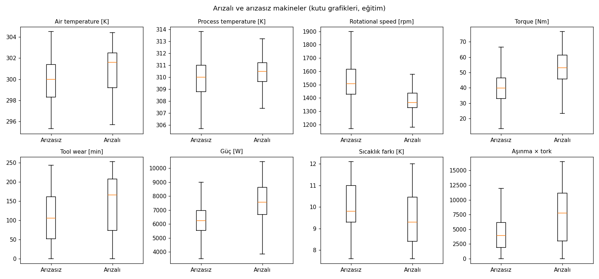
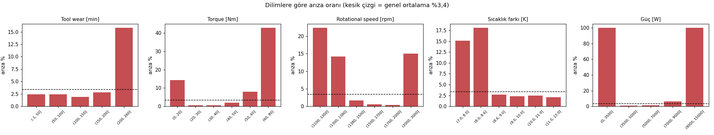
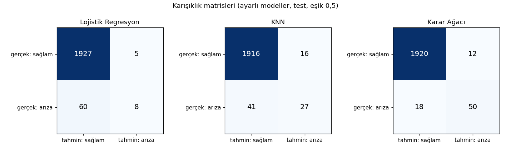
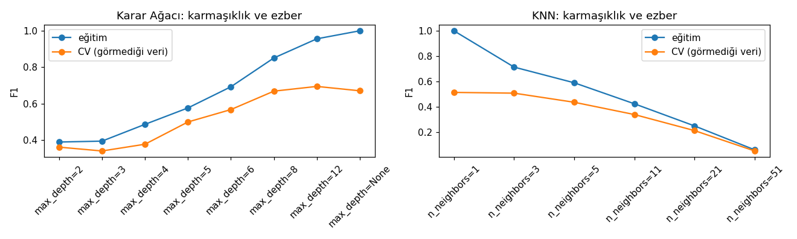

# AI4I 2020 — Makine Arızası Tahmini: Sınav Raporu

| İsim-Soyisim | Öğrenci No | Bölüm | Ders | Dönem |
|---|---|---|---|---|
| **Tuğba Tuana Kaygısız** | **2511317024** | MAKÜ-FEF Veri Bilimi ve Analitiği (VBA) | Makine Öğrenmesi — Arasınav (Bilgisayar Bölümü, Soru 1–3) | 2026-2027 Güz |

Veri: UCI AI4I 2020 Predictive Maintenance (10.000 kayıt, 14 sütun), hedef <code>Machine failure</code>. Bütün sayılar ve grafikler <code>kod/sinav_cozumu.ipynb</code> defterinden gelir (<code>random_state=42</code>, yeniden çalıştırınca aynı sonuç). Veride eksik hücre ve tekrar eden satır yok. Keşif analizi yalnız eğitim kümesinde yapıldı; test kümesi yalnız son ölçümde kullanıldı.

## SORU 1 — Veriyi tanıma ve problemi anlama

### a) Machine failure dağılımı ve sınıflandırma zorluğu

10.000 kaydın **9.661'i arızasız (%96,6), 339'u arızalı (%3,4)**. Zorluklar:

- **Ciddi sınıf dengesizliği:** "Hiçbir makine arızalanmaz" diyen boş bir tahmin bile %96,6 accuracy alır ama tek arıza yakalayamaz. Accuracy yanıltıcıdır; **recall, precision ve F1** birlikte kullanılmalıdır.
- **Az arıza örneği:** Model yalnız 271 arıza (eğitim) görerek öğrenir. Bölme **stratified** olmalı, sonuçlar **K-Fold** ile doğrulanmalıdır.
- **Tek etiket altında birden çok neden:** ısı (HDF), güç (PWF), zorlanma (OSF), takım aşınması (TWF) ve rastgele (RNF) arızalar aynı etikette. Rastgele arızalar hiçbir sensörle öngörülemez; %100 başarı mümkün değildir.

### b) Arızalı ve arızasız makinelerin karşılaştırılması (eğitim kümesi)

| Değişken | Arızasız ort. | Arızalı ort. | Arızalı medyan | Fark | Tek başına AUC* |
|---|---|---|---|---|---|
| Tork [Nm] | 39,7 | 50,2 | 53,2 | **+%26,5** | **0,77** |
| Dönüş hızı [rpm] | 1.541 | 1.501 | 1.366 | −%2,6 (medyanda −%9) | **0,76** |
| Takım aşınması [dk] | 106,5 | 141,4 | 166 | **+%32,8** | 0,65 |
| Hava sıcaklığı [K] | 300,0 | 300,9 | 301,6 | +%0,3 | 0,64 |
| İşlem sıcaklığı [K] | 310,0 | 310,3 | 310,5 | +%0,1 | 0,57 |
| Güç [W] = tork × devir (hesaplanan) | 6.247 | 7.291 | 7.559 | +%16,7 | 0,74 |
| Sıcaklık farkı [K] = işlem − hava (hesaplanan) | 10,0 | 9,4 | 9,3 | −%6,1 | 0,66 |

* Yalnız o değişkenle arızalıyı arızasızdan ayırma gücü (0,5 = ayıramaz, 1 = kusursuz).

Ortalamalar tek başına yetmediği için arızanın **hangi aralıkta** sıklaştığına bakıldı (genel ortalama %3,4):

Arıza oranı: takım aşınması > 200 dk → **%15,8** (altında %2–3) · tork > 60 Nm → **%42,8**, tork < 20 Nm → %14,3 (20–40 Nm arasında %0,6) · devir < 1.300 rpm → **%22,4**, > 2.000 rpm → %15 · sıcaklık farkı < 8,6 K → **%15–18** · güç < 3.500 W ya da > 9.000 W → **%100** (82 kaydın tamamı) · tork 60–80 Nm ve devir 1.380–1.500 rpm birlikte → **%61,9** · ürün kalitesi L / M / H → %4,1 / %2,4 / %2,0.

**Üretim yönetimi için çıkarımlar:** (1) Takımlar 200 dakikaya gelmeden değiştirilmeli; sonrasında arıza yaklaşık 6 kat artıyor. (2) Makine 3.500–9.000 W güç aralığında tutulmalı; **yüksek tork + düşük devir** en tehlikeli çalışma noktası. (3) İşlem ile ortam sıcaklığı farkı 8,6 K'nin altına düşerse soğutma artırılmalı ya da devir yükseltilmeli. (4) Düşük kaliteli (L tipi) ürün hatlarında arıza iki kat sık; bakım daha sık planlanmalı.

### c) Arıza tahmini için daha yararlı değişkenler

**Tork** ve **dönüş hızı** en güçlü iki değişken (AUC 0,77 ve 0,76): arızaların çoğu aşırı yükte ya da düşük devirde oluyor, kutu grafiklerinde iki grup açıkça ayrışıyor. **Takım aşınması** ortalamada orta düzeyde (0,65) ama 200 dk eşiğinden sonra çok belirleyici. **Hava ve işlem sıcaklığı tek başına zayıf**; asıl bilgi ikisinin **farkında** (fark küçükse makine ısıyı atamıyor). En yararlı bilgi değişkenlerin **birleşimlerinde**: güç (tork × devir), aşınma × tork ve sıcaklık farkı arızanın fiziksel nedenini doğrudan ölçüyor (etkisi Soru 3b'de gösterildi). Type zayıf bir yardımcı değişken. UDI ve Product ID kimliktir; TWF/HDF/PWF/OSF/RNF ise arızanın sonucudur (sızıntı) — hiçbiri modele verilmedi.

## SORU 2 — Arıza tahmin modelleri

### a) Eğitim / test bölmesi ve ön işleme

| Tercih | Ne yapıldı | Neden |
|---|---|---|
| Bölme | **%80 / %20, stratified**, `random_state=42` → eğitim 8.000 (271 arıza), test 2.000 (68 arıza) | Arıza çok az; stratify olmasa test kümesine şans eseri çok az arıza düşebilirdi |
| Çıkarılanlar | UDI, Product ID, TWF, HDF, PWF, OSF, RNF | Kimlikler bilgi taşımaz; arıza türleri sonucun kendisidir (sızıntı) |
| Girdiler | Type (L<M<H sırasıyla 0/1/2), hava ve işlem sıcaklığı, devir, tork, takım aşınması | Tahmin anında bilinen değerler; Type'ın doğal sırası var |
| Ölçekleme | LR ve KNN'de StandardScaler; ağaçta yok | KNN uzaklıkla çalışır, ölçeksiz devir (~1.500) torku (~40) bastırırdı; ağaç ölçekten etkilenmez |
| Sızıntı önlemi | Ölçekleme ve kodlama Pipeline içinde | Her çapraz doğrulama katında yalnız eğitim kısmından öğrenilir |
| Aykırı değer | Silinmedi | Aykırı torklu 56 kaydın %89'u arıza: aykırı değer arıza sinyalinin kendisi |
| Ayar seçimi | Eğitimde **5 katlı Stratified K-Fold + GridSearch**, ölçüt F1 | Test kümesi ayar seçiminde hiç kullanılmadı. Seçilenler: LR C=10 · KNN k=3 (uzaklık ağırlıklı) · ağaç derinlik 10, yaprakta ≥ 10 kayıt |

### b) Test kümesinde üç modelin karşılaştırması (2.000 kayıt, 68 arıza, eşik 0,5)

| Model | Accuracy | Precision | Recall | F1 | Kaçan arıza (FN) | Yanlış alarm (FP) | 5×5 tekrarlı CV F1 |
|---|---|---|---|---|---|---|---|
| Lojistik Regresyon | 0,968 | 0,615 | 0,118 | 0,198 | 60 | 5 | 0,315 ± 0,065 |
| KNN | 0,972 | 0,628 | 0,397 | 0,487 | 41 | 16 | 0,510 ± 0,061 |
| **Karar Ağacı** | **0,985** | **0,806** | **0,735** | **0,769** | **18** | **12** | **0,685 ± 0,048** |
| Kıyas: herkese "arızasız" de | 0,966 | 0 | 0 | 0 | 68 | 0 | — |

Sıralama hem testte hem 25 ölçümlük tekrarlı çapraz doğrulamada aynı: **Karar Ağacı > KNN > Lojistik Regresyon**. Lojistik Regresyon zayıf, çünkü her değişken için tek yönlü etki öğrenir; oysa arıza hem çok düşük hem çok yüksek güçte oluyor. Ağaç bu "iki uçlu" yapıyı eşik kurallarıyla doğrudan öğrenir.

### c) En yüksek accuracy = fabrika için en iyi model mi?

Hayır, **accuracy'ye göre seçim yapılamaz.** Bu veride en yüksek accuracy'li model (ağaç, 0,985) recall ve F1'de de birinci, ama bu accuracy'nin doğru ölçüt olduğunu göstermez: üç modelin accuracy'si neredeyse aynı (0,968–0,985) iken recall 0,12 ile 0,74 arasında değişiyor. Lojistik Regresyon'un %96,8'i, hiçbir şey yapmayan boş tahminin %96,6'sıyla aynı düzeyde; ama 68 arızanın yalnız 8'ini buluyor. Fabrika için önemli olan doğru tahmin yüzdesi değil, **kaçan arıza sayısı (recall)**, **yanlış alarm yükü (precision)** ve bunların maliyetidir. En yüksek accuracy'li model bile 0,5 eşiğinde 18 arıza kaçırıyor; eşiğin ayrıca ayarlanması gerekir.

### d) Seçilen model: Karar Ağacı (operasyonel gerekçelerle)

- **Maliyet:** Yanlış alarm 1 birim, kaçan arıza c birim sayıldı; her modelin eşiği eğitimdeki çapraz doğrulama tahminleriyle seçilip testte ölçüldü. Duruş ne kadar pahalı olursa olsun en düşük toplam maliyet ağaçta (diğerlerinin yaklaşık yarısı):

| Kaçan arıza maliyeti (c) | Lojistik Regresyon | KNN | **Karar Ağacı** | Ağacın eşiği → kaçan arıza / yanlış alarm |
|---|---|---|---|---|
| 1 | 65 | 56 | **28** | 0,51 → 18 / 10 |
| 5 | 215 | 209 | **103** | 0,29 → 15 / 28 |
| 10 | 346 | 344 | **175** | 0,07 → 12 / 55 |
| 20 | 551 | 614 | **310** | 0,02 → 9 / 130 |

- **Açıklanabilirlik:** Bakım ekibi alarmın nedenini okuyabilir: "tork > 65 Nm ve devir > 1.292 → arıza", "tork ≤ 13,4 Nm → arıza", "devir ≤ 1.380 ise sıcaklıklara bak", "aşınma > 204,5 dk → riskli". Bu kurallar Soru 1'deki bulgularla örtüşüyor. KNN'nin kararı "en benzer 3 kayıt böyleydi" demektir; açıklanamaz.
- **Hız ve bakım:** 2.000 kaydı ağaç yaklaşık 2 ms'de, KNN yaklaşık 15 ms'de tahmin ediyor. KNN bütün eğitim verisini saklayıp her tahminde taramak zorunda; ağaç tek bir kural listesidir, hat kontrol sistemine gömülebilir.
- **Kararlılık ve esneklik:** Tekrarlı ölçümde F1 sapması en düşük model. Duruş pahalıysa eşik düşürülür (c=10 için eşik 0,07: 68 arızanın 56'sı yakalanır, 55 yanlış alarm).
- **Zayıf yanı:** Kayıtlar zaman sırasında. "İlk 8.000 kayıtla eğit, son 2.000'i tahmin et" denemesinde ağacın F1'i 0,77'den 0,47'ye düşüyor, çünkü yavaş değişen hava sıcaklığından "hangi dönemdeyiz" bilgisini ezberliyor. Çözüm 3b'de: fiziksel özelliklerle aynı testte F1 0,84.

## SORU 3 — Modeli gerçek hayatta kullanmak

### a) Daha kritik hata

**Kaçan arıza (yanlış negatif) daha kritiktir.** Arızalanacak makineye "sağlam" demek planlanmamış duruş demektir: hat bekler, yarım kalan ürün hurdaya çıkar, teslimat gecikir, iş güvenliği riski doğar. Yanlış alarm ise planlı yapılabilen kısa bir kontrol ve gereksiz bakım maliyetidir; üretimi durdurmaz. Öncelik **recall**; ancak yanlış alarm sınırsız artarsa bakım bütçesi şişer ve ekip alarmlara güvenmez, bu yüzden precision da izlenmelidir. 2d'deki maliyet hesabında kaçan arızanın en az 5 kat pahalı olduğu her durumda en iyi eşik 0,5'in altında çıkıyor.

### b) Arıza yakalamayı artıracak değişiklikler ve olumsuz sonuçları

| Değişiklik | Bu veride ölçülen etki (karar ağacı, test) | Olumsuz sonucu |
|---|---|---|
| **Karar eşiğini düşürmek** (0,5 → 0,2) | Kaçan arıza 18 → 15 | Yanlış alarm 12 → 35 (yaklaşık 3 kat): gereksiz bakım, alarm yorgunluğu |
| **Fiziğe dayalı yeni özellikler:** güç = tork × devir × 2π/60; sıcaklık farkı; aşınma × tork; zorlanma oranı = (aşınma × tork) / kalite tipinin sınırı (L 11.000, M 12.000, H 13.000 — veri setinin belgesinden, veri dışı bilgi) | CV F1 0,685 → **0,891**; test F1 0,769 → **0,876**; kaçan arıza 18 → 15, yanlış alarm 12 → **0**. Zaman sıralı testte F1 0,47 → **0,84** | Sınırlar bu sentetik verinin belgesinden; kazancın büyüklüğü verinin bu kurallarla üretilmesinden. Gerçek fabrikada üretici verileriyle yeniden belirlenmeli; yanlış sınır modeli yanıltır |
| **Sınıf ağırlığı / azınlık sınıfı çoğaltma** | Arızalara daha çok ağırlık → recall artar | Yanlış alarm hızla artar; yapay örnekler gerçekte olmayan arızalar üretebilir |
| **Daha çok veri, yeni sensörler** (titreşim, akım), daha güçlü modeller | Öngörülemeyen arızaların bir kısmı görünür hâle gelir | Maliyet ve kurulum süresi; açıklanabilirlik azalır |

Yeni özelliklerle ağaç artık hava sıcaklığına değil zorlanma oranına, güce, devire ve sıcaklık farkına bakıyor; yani dönemi ezberlemek yerine arızanın gerçek nedenini öğreniyor. Yine de %100 yakalama beklenmemeli: rastgele arızalar sensörlerle öngörülemez (zaman sıralı testte en iyi model 39 arızanın 11'ini kaçırıyor).

### c) Eğitimde çok yüksek, testte düşük başarı

Bu **aşırı öğrenmedir (overfitting):** model genel kuralı değil, eğitim verisindeki rastlantısal ayrıntıları ezberlemiştir. Bu veride ölçüldü (F1; CV = modelin görmediği kısım):

| Model / ayar | Eğitim | CV | Fark | | Model / ayar | Eğitim | CV | Fark |
|---|---|---|---|---|---|---|---|---|
| Ağaç, sınırsız derinlik | 1,000 | 0,671 | 0,329 | | KNN, k = 1 | 1,000 | 0,513 | 0,487 |
| **Ağaç, seçilen** (derinlik 10, yaprakta ≥ 10) | 0,785 | 0,727 | **0,058** | | KNN, k = 5 | 0,589 | 0,435 | 0,154 |

**Öneri 1 — Modeli sadeleştirmek:** ağaçta maksimum derinliği sınırlamak ve yaprakta en az kayıt şartı koymak (budama), KNN'de daha büyük k, Lojistik Regresyon'da daha güçlü düzenlileştirme. Bu veride yaprak şartı eğitim–CV farkını 0,33'ten 0,06'ya indirdi.
**Öneri 2 — Ayarları K-Fold çapraz doğrulamayla seçmek ve test kümesini korumak:** derinlik, k gibi ayarlar eğitim başarısına göre değil doğrulama skoruna göre seçilmeli; test kümesi yalnız en sonda bir kez kullanılmalı (veri zaman sıralı olduğu için doğrulama da sırayı korumalı). Ek olarak daha çok arıza verisi toplamak ve dönemi ezberleten girdiler yerine fiziksel anlamı olan özellikler kullanmak ezberi azaltır.
